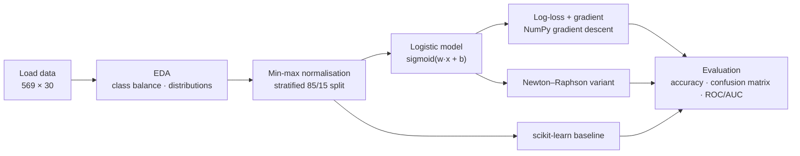
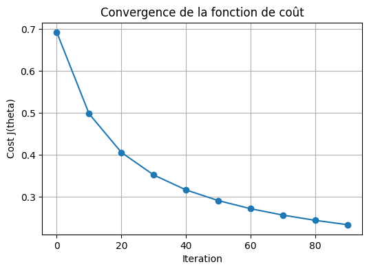
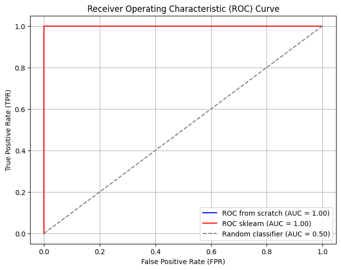

<div align="center">

# 📐 Logistic Regression From Scratch

**Theory, derivation and a pure-NumPy implementation of logistic regression — validated against scikit-learn on breast-cancer diagnosis.**


</div>

---

## 📌 Overview

An educational notebook ([`logistic_regression_from_scratch.ipynb`](./logistic_regression_from_scratch.ipynb), written in French) that walks through logistic regression end to end: data exploration, the mathematical model, the log-loss cost, the gradient derivation, **batch gradient descent implemented from scratch with NumPy**, evaluation, a comparison with `sklearn.linear_model.LogisticRegression`, and a **Newton–Raphson** variant. A written report is provided in [`rapport-logistic-regression.pdf`](./rapport-logistic-regression.pdf).

## 🗂️ Dataset

[Breast Cancer Wisconsin (Diagnostic)](https://www.kaggle.com/datasets/uciml/breast-cancer-wisconsin-data) — 569 samples, 30 numeric features describing cell nuclei; 357 benign (0) and 212 malignant (1). Features are **min-max normalised**; the split is **stratified 85 % / 15 %** (483 train / 86 test, `random_state=42`).

## 🧭 Workflow



## 📊 Results

Gradient descent from scratch: learning rate **1.0**, **100 iterations**; the cost decreases monotonically from 0.6928 to ≈ 0.23.

| Model | Train accuracy | Test accuracy |
|---|---:|---:|
| From scratch (gradient descent) | 94.41 % | 95.35 % |
| scikit-learn `LogisticRegression` | 96.89 % | **98.84 %** |

scikit-learn confusion matrix on the 86 test samples: 54 benign and 31 malignant correct, 1 malignant missed (precision/recall for malignant = 1.00 / 0.97). Both ROC curves show AUC = 1.00 on this small test set (printed to two decimals).

<p align="center">
  
  
</p>

**Caveat.** With only 86 test samples a single prediction changes accuracy by ≈ 1.2 points, so the 3.5-point gap between the two implementations is not statistically conclusive; the from-scratch model is deliberately unregularised and un-tuned.

## ✅ Verification Status

Accuracies, the confusion matrix and the cost curve are copied from the executed notebook outputs; the notebook was **not re-run** (it reads `/content/data.csv`). The AUC values are visible only in the ROC figure legend.

## 🧰 Tech Stack

NumPy · pandas · matplotlib · seaborn · scikit-learn (comparison only)

## 🚀 Run

```bash
pip install numpy pandas matplotlib seaborn scikit-learn jupyter
jupyter notebook logistic_regression_from_scratch.ipynb
```

The notebook was written for Google Colab and reads `/content/data.csv`: download `data.csv` from Kaggle and either upload it to Colab or change the path in the loading cell.

## 🔭 Extensions

- Add L2 regularisation and learning-rate scheduling; compare optimisers (SGD, Newton, L-BFGS).
- Use cross-validation instead of a single split and report confidence intervals.

## 👤 Author

**Nour Ghribi** · [GitHub](https://github.com/Nour-Ghribi)
